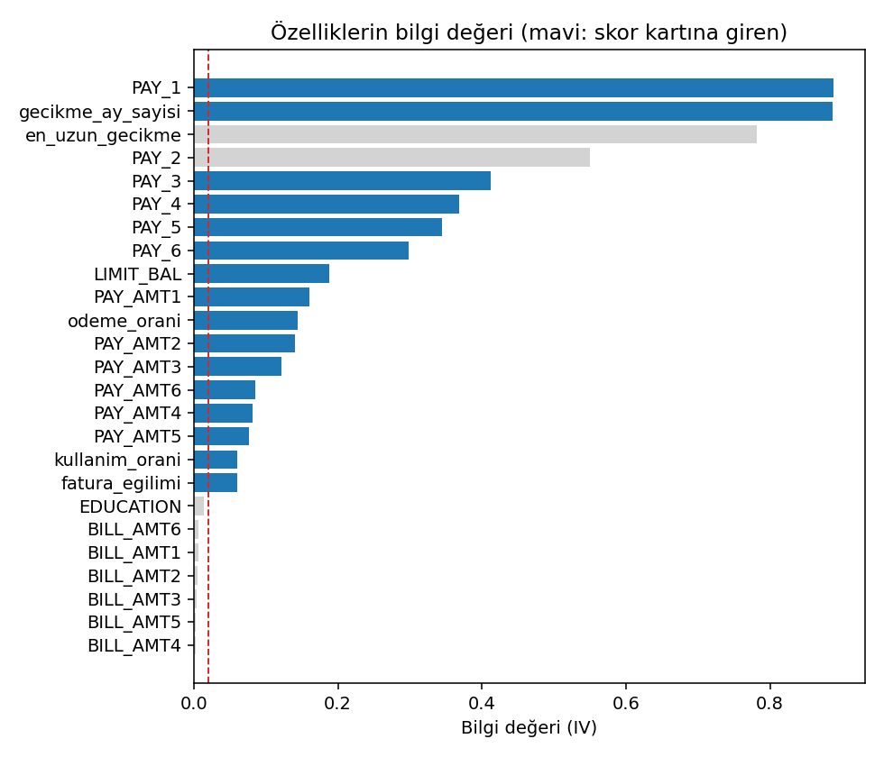
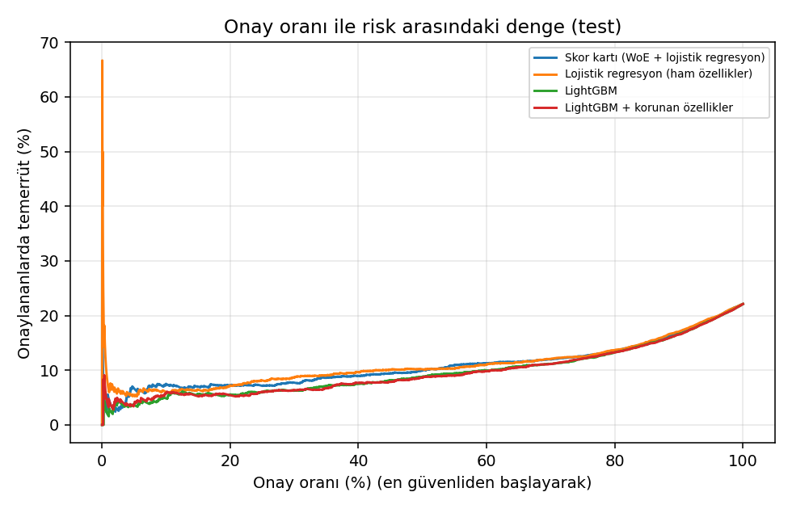
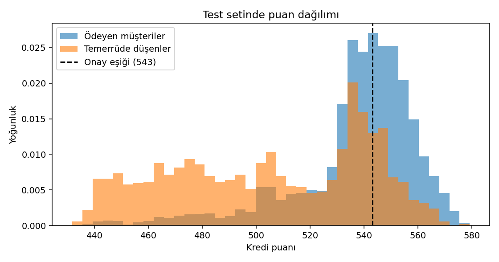

# Kredi Riski Skorlama

Kredi kartı müşterilerinin bir sonraki ay borcunu ödeyip ödemeyeceğini tahmin eden, bankacılıkta kullanılan
biçimde bir **kredi skor kartı**. Her başvuruya bir puan veriliyor, puan eşiğe göre onay ya da red kararı
çıkıyor ve reddedilen başvurulara **neden** reddedildiği söyleniyor.

- WoE (Weight of Evidence) dönüşümü, monoton aralık birleştirme, IV ile özellik seçimi ve puan ölçekleme:
  hepsi sıfırdan yazıldı (`src/skorkarti.py`)
- Skor kartının LightGBM ve düz lojistik regresyonla karşılaştırması (AUC, Gini, KS)
- Kâra göre onay eşiği ve puan bantları
- **Adillik analizi:** cinsiyet, yaş ve medeni hal modelde kullanılmıyor; buna rağmen kararlar bu gruplara
  eşit davranıyor mu?
- FastAPI servisi (karar + puanı düşüren nedenler + skor kartının kendisi), testler, Dockerfile

## Veri

[UCI Default of Credit Card Clients](https://archive.ics.uci.edu/dataset/350/default+of+credit+card+clients)
(Tayvan, 2005): 30.000 kredi kartı müşterisi, %22,1'i bir sonraki ay temerrüde düşmüş. Kredi limiti, eğitim,
son 6 ayın ödeme durumları (gecikme ay sayısı), fatura ve ödeme tutarları. Bunlardan 5 özellik daha türettim:
limit kullanım oranı, faturaların ödenme oranı, gecikmeli ay sayısı, en uzun gecikme, borcun 6 aylık artışı.

%60 eğitim / %20 doğrulama / %20 test. Eşik doğrulama setinde seçildi, sonuçlar test setinde (6.000 müşteri).

## Skor kartı

1. Her özellik önce 10 eşit frekanslı aralığa bölünüyor, sonra komşu aralıklar **WoE tek yönde değişene** ve
   her aralıkta en az %5 müşteri olana kadar birleştiriliyor. Böylece örneğin "gecikme arttıkça puan artmaz".
2. Bilgi değeri (IV) 0,02'nin altındaki özellikler atılıyor (fatura tutarları ve eğitim), birbirine çok
   benzeyenlerden IV'si yüksek olan tutuluyor.
3. WoE değerleriyle lojistik regresyon eğitiliyor. Katsayısı ters işaretli çıkan değişken (`PAY_2`, diğer
   ödeme durumlarıyla neredeyse aynı bilgiyi taşıyor) çıkarılıp yeniden eğitiliyor.
4. Puan ölçekleme: 50:1 iyi/kötü oranı 600 puan, oran ikiye katlandığında +20 puan. Her özelliğin her aralığı
   tabloda bir puana karşılık geliyor ([`reports/puan_tablosu.csv`](reports/puan_tablosu.csv)).

Sonuçta 16 özellikli bir kart çıktı. Örnek: son ay ödeme durumu

| Son ay ödeme durumu | Temerrüt oranı | Puan |
| --- | --- | --- |
| Kartı kullanmamış | %12 | 46 |
| Tam ya da asgari ödeme | %14 | 43 |
| 1 ay gecikme | %33 | 22 |
| 2+ ay gecikme | %70 | -7 |



## Sonuçlar (test, 6.000 müşteri)

| Model | AUC | Gini | KS | Onay oranı | Onaylananda temerrüt | Kâr |
| --- | --- | --- | --- | --- | --- | --- |
| **Skor kartı** (servis edilen) | 0,767 | 0,533 | 0,418 | %40 | %9,0 | 1.114 |
| Lojistik regresyon (ham özellikler) | 0,762 | 0,525 | 0,422 | %65 | %11,4 | 1.230 |
| LightGBM | 0,790 | 0,579 | 0,450 | %50 | %8,8 | 1.411 |
| LightGBM + korunan özellikler | 0,791 | 0,582 | 0,448 | %56 | %9,1 | 1.517 |
| Herkesi onayla | | | | %100 | %22,1 | -1.962 |

Kâr varsayımı: onaylanan ve ödeyen müşteri +1 birim, onaylanan ve temerrüde düşen -5 birim (kaybedilen anapara,
bir müşteriden kazanılan faizden kat kat büyük). Her modelin eşiği doğrulama setinde kârı en yüksek yapacak şekilde seçildi.

- **LightGBM daha iyi ayırıyor** (Gini 0,58'e karşı 0,53). Buna rağmen servis skor kartını kullanıyor: her kararın
  tek bir puan tablosuyla açıklanabilmesi ve reddedilen başvuruya gerekçe verilebilmesi bankacılıkta düzenleyici bir
  gereklilik. Gerçek bir projede LightGBM'in fazladan kârı ile açıklanabilirlik arasındaki bu tercih iş birimiyle
  birlikte yapılır.
- Skor kartının eşiği temkinli çıktı (%40 onay). Eşik kâr varsayımına çok bağlı; 1:5 yerine 1:3 alınsa daha fazla
  müşteri onaylanır.



### Puan dağılımı ve bantlar



| Puan bandı | Müşteri | Temerrüt oranı |
| --- | --- | --- |
| 480 ve altı | 589 | %69,4 |
| 480-500 | 326 | %52,5 |
| 500-520 | 634 | %30,1 |
| 520-540 | 1.588 | %17,8 |
| 540-560 | 2.386 | %10,0 |
| 560 üstü | 477 | %7,3 |

Puan arttıkça temerrüt oranı düzenli düşüyor. Onay eşiği 543 puan.

## Adillik

Cinsiyet, yaş ve medeni hal modele hiç girmiyor. Yine de diğer özellikler (ör. kredi limiti) bu gruplarla ilişkili
olabileceği için kararların gruplara göre dağılımına baktım. "İyilerde onay": gerçekten ödeyecek müşterilerin
onaylanma oranı (fırsat eşitliği).

| Grup | Müşteri | Gerçek temerrüt | Onay oranı | İyilerde onay | Onaylananda temerrüt |
| --- | --- | --- | --- | --- | --- |
| Erkek | 2.372 | %24,1 | %37,5 | %44,9 | %9,1 |
| Kadın | 3.628 | %20,8 | %42,2 | %48,5 | %9,0 |
| Yaş <30 | 1.926 | %21,9 | %33,3 | %38,9 | %8,9 |
| Yaş 30-44 | 2.952 | %20,8 | %46,9 | %54,5 | %7,9 |
| Yaş 45+ | 1.122 | %26,0 | %35,1 | %41,3 | %12,9 |

En düşük / en yüksek onay oranı (4/5 kuralı, 0,8'in altı dikkat ister; 100 kişiden küçük gruplar hariç):

| | Cinsiyet | Yaş | Medeni hal |
| --- | --- | --- | --- |
| Skor kartı (korunan özellik yok) | 0,89 | **0,71** | 0,94 |
| LightGBM + korunan özellikler | 0,92 | 0,88 | 0,93 |

- **Cinsiyet:** fark küçük ve gerçek temerrüt farkıyla uyumlu; ödeyecek müşterilerin onaylanma oranı da yakın.
- **Yaş sorunlu:** 30 yaş altı müşteriler, temerrüt oranları 30-44 grubuyla neredeyse aynı olduğu halde çok daha az
  onaylanıyor (ödeyecek gençlerin %39'u, 30-44 yaştakilerin %55'i). Büyük ihtimalle sebep kredi limiti: gençlerin
  limiti düşük, skor kartı da düşük limite daha az puan veriyor. Yaş modelde olmasa bile limit üzerinden dolaylı olarak
  etkiliyor.
- İlginç olan, yaşı doğrudan kullanan LightGBM'in daha dengeli kararlar vermesi. Ama yaşı kredi kararında kullanmak
  birçok ülkede yasal olarak kısıtlı. Doğru çözüm muhtemelen limit gibi dolaylı değişkenlerin etkisini sınırlamak ya da
  gruplara göre eşik ayarlamak; bunun için hem hukuki hem iş tarafının kararı gerekiyor.

## API

```bash
uvicorn api.app:app      # http://127.0.0.1:8000/docs
```

| Uç nokta | Açıklama |
| --- | --- |
| `GET /saglik` | Servis durumu, puan eşiği |
| `POST /basvuru` | Puan, temerrüt olasılığı, onay/red, puanı en çok düşüren 3 özellik |
| `GET /skor-karti` | Puan tablosunun tamamı |

Reddedilen bir başvuru için örnek cevap:

```json
{"puan": 432, "temerrut_olasiligi": 0.8719, "karar": "red", "esik": 543.2,
 "puani_dusurenler": [{"ozellik": "Ödeme durumu (son ay)", "kaybedilen_puan": 52.9},
                      {"ozellik": "Son 6 ayda gecikmeli ay sayısı", "kaybedilen_puan": 18.7},
                      {"ozellik": "Limit kullanım oranı", "kaybedilen_puan": 9.7}]}
```

Docker ile:

```bash
docker build -t kredi-skor .
docker run -p 8000:8000 kredi-skor
```

## Çalıştırma

```bash
python -m venv .venv
.venv\Scripts\activate          # Linux/macOS: source .venv/bin/activate
pip install -r requirements.txt
```

UCI sayfasından zip dosyasını indirip içindeki `default of credit card clients.xls` dosyasını `data/indirme/` altına koyun.

```bash
python -m src.egit      # skor kartı, karşılaştırma, eşik, adillik, grafikler
pytest
```

## Klasör yapısı

```
src/
  veri.py          veri okuma, temizlik, türetilen özellikler
  skorkarti.py     WoE, monoton aralıklar, IV, puan ölçekleme, red nedenleri
  metrikler.py     AUC, Gini, KS, kâr
  egit.py          eğitim, karşılaştırma, eşik, puan bantları, adillik
  cikarim.py       başvuru değerlendirme (API için)
api/app.py         FastAPI servisi
tests/             API testleri
models/            skor kartı ve eşik
reports/           puan tablosu, sonuçlar, adillik tabloları, grafikler
```

## Sınırlamalar

- Veri 2005 Tayvan'ından; makroekonomik koşullar değiştikçe skor kartının yeniden kalibre edilmesi gerekir
  (bankalarda bunun için PSI ile düzenli izleme yapılır).
- Sadece onaylanmış müşterilerin verisi var; reddedilenlerin ne yapacağı bilinmiyor (reject inference yapılmadı).
- Kâr varsayımı basit; gerçekte limit, faiz ve geri tahsilat oranına göre müşteri bazında hesaplanır.

## Yazar

Batın Dikilitaş, Kocaeli Üniversitesi Yapay Zeka ve Makine Öğrenmesi
